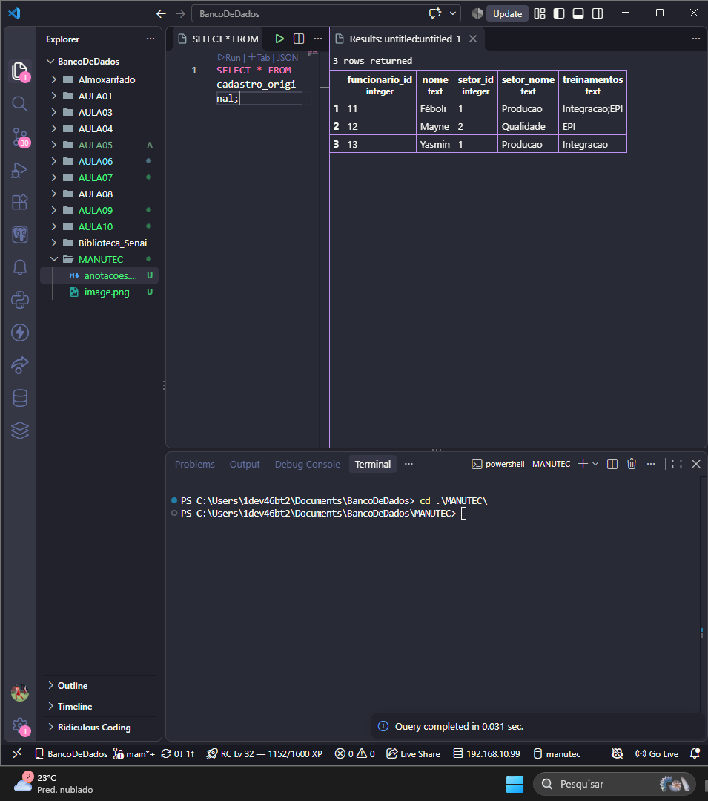
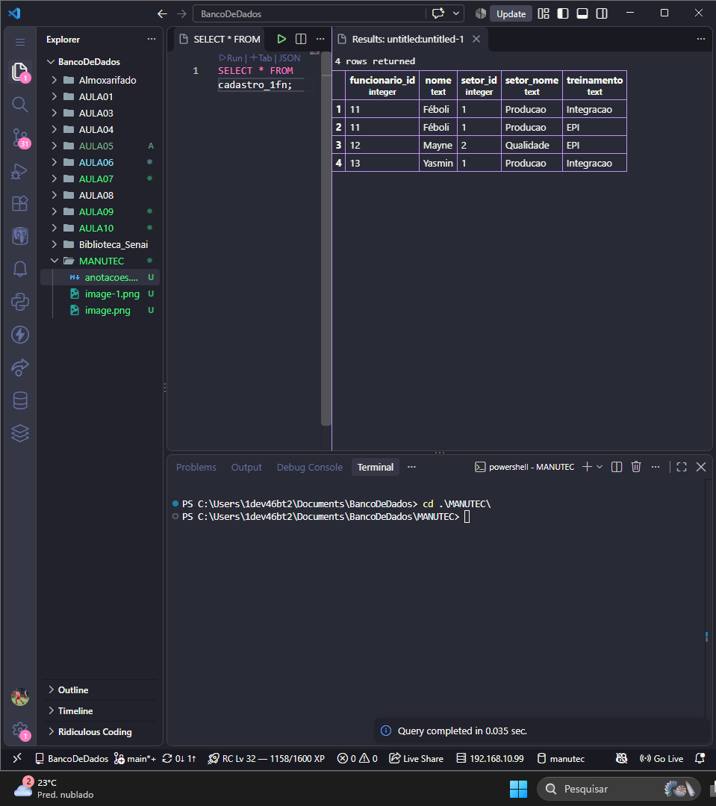
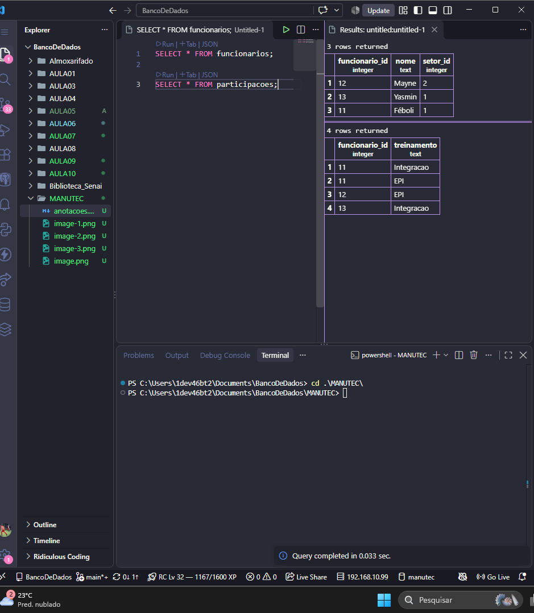
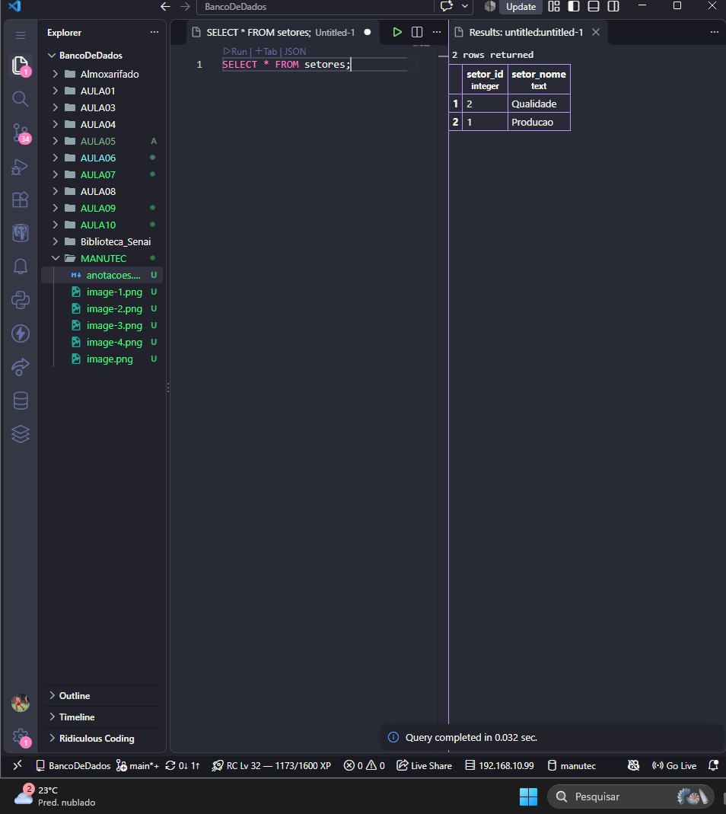
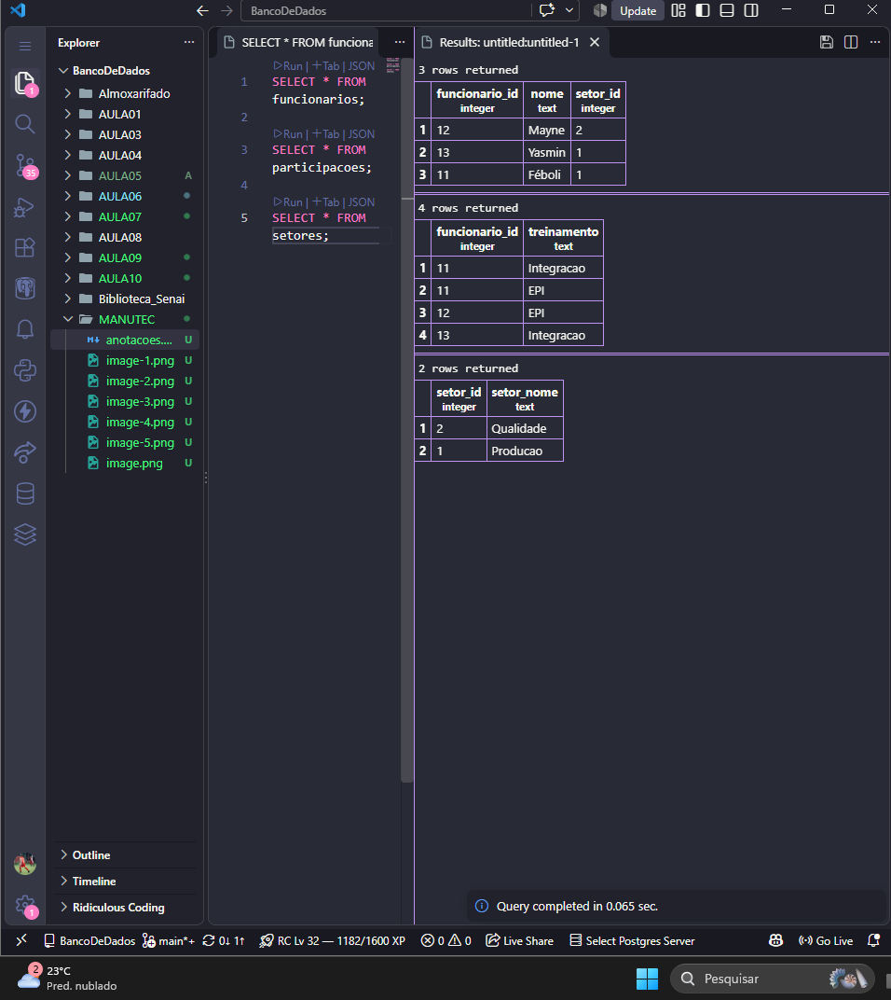

## Atividade prática 12 - Normalização de Banco de Dados

1-Primeiro Criamos a tabela:
```sql

CREATE TABLE cadastro_original (
    funcionario_id INTEGER PRIMARY KEY,
    nome TEXT,
    setor_id INTEGER,
    setor_nome TEXT,
    treinamentos TEXT
);

INSERT INTO cadastro_original VALUES
(11, 'Féboli', 1, 'Producao', 'Integracao;EPI'),
(12, 'Mayne', 2, 'Qualidade', 'EPI'),
(13, 'Yasmin', 1, 'Producao', 'Integracao');

```

2- Criar cadastro_1fn, separando os treinamentos e usando chave primária composta..

```sql
CREATE TABLE cadastro_1fn (
    funcionario_id INTEGER,
    nome TEXT,
    setor_id INTEGER,
    setor_nome TEXT,
    treinamento TEXT,
    PRIMARY KEY (funcionario_id, treinamento)
);

INSERT INTO cadastro_1fn VALUES
(11, 'Féboli', 1, 'Producao', 'Integracao'),
(11, 'Féboli', 1, 'Producao', 'EPI'),
(12, 'Mayne', 2, 'Qualidade', 'EPI'),
(13, 'Yasmin', 1, 'Producao', 'Integracao');
```

3- Criar funcionarios usando DISTINCT:
```sql
CREATE TABLE funcionarios (
    funcionario_id INTEGER PRIMARY KEY,
    nome TEXT,
    setor_id INTEGER,
    setor_nome TEXT
);

INSERT INTO funcionarios
SELECT DISTINCT funcionario_id, nome, setor_id, setor_nome
FROM cadastro_1fn;
```
```sql
Criar participacoes:
CREATE TABLE participacoes (
    funcionario_id INTEGER,
    treinamento TEXT,
    PRIMARY KEY (funcionario_id, treinamento),
    FOREIGN KEY (funcionario_id)
        REFERENCES funcionarios(funcionario_id)
);

INSERT INTO participacoes
SELECT funcionario_id, treinamento
FROM cadastro_1fn;
```

4- Criar setores sem repetição:
```sql
CREATE TABLE setores (
    setor_id INTEGER PRIMARY KEY,
    setor_nome TEXT
);

INSERT INTO setores
SELECT DISTINCT setor_id, setor_nome
FROM funcionarios;
```
```sql
Adicionar a chave estrangeira, exigir o preenchimento de setor_id e retirar setor_nome de funcionarios:
ALTER TABLE funcionarios
ALTER COLUMN setor_id SET NOT NULL;

ALTER TABLE funcionarios
ADD CONSTRAINT fk_funcionarios_setores
FOREIGN KEY (setor_id)
REFERENCES setores(setor_id);

ALTER TABLE funcionarios
DROP COLUMN setor_nome;
```
Mostrando os resultados das tabelas:
Tabela original:

Primeira Forma Normal (1FN):

Segunda Forma Normal (2FN):
0
Terceira Forma Normal (3FN)

Tabelas finais:
